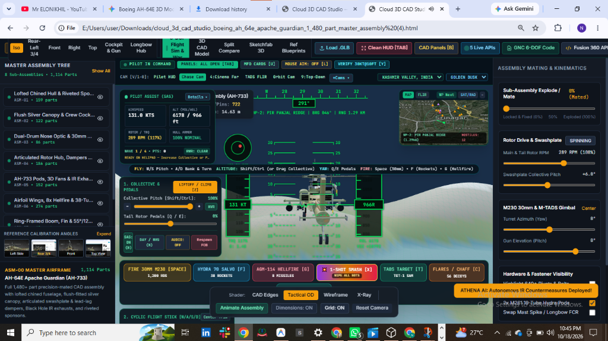
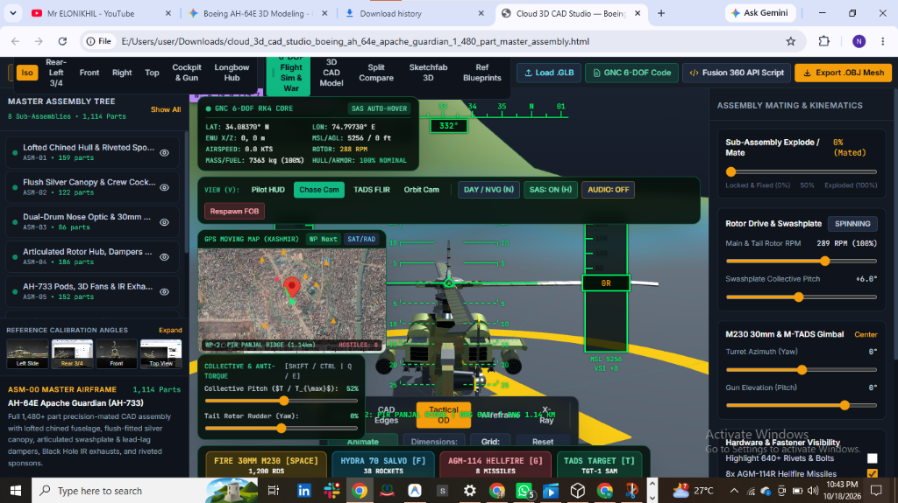
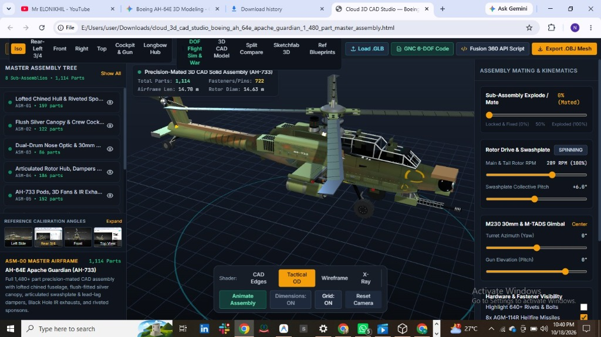

# PROJECT-12: Boeing AH-64E Apache Guardian Border Defense Combat Flight Simulator

[](https://batturamesh7771-sketch.github.io/PROJECT-12-BOEING-AH-64E-APACHE-WAR-SIMULATOR/)
[](https://github.com/batturamesh7771-sketch)
[](LICENSE)
[](https://playcanvas.com/)
[](docs/SYSTEM_ARCHITECTURE.md)
[](scripts/process_apache_cad_blender.py)

---

## 🚀 Instant Play in Your Browser (Free, Laptop-Friendly, Zero Setup)

Click any of the instant web links below to run the complete simulation directly in your browser:

* **Primary GitHub Pages Live Link:**  
  👉 **[https://batturamesh7771-sketch.github.io/PROJECT-12-BOEING-AH-64E-APACHE-WAR-SIMULATOR/](https://batturamesh7771-sketch.github.io/PROJECT-12-BOEING-AH-64E-APACHE-WAR-SIMULATOR/)**
* **Direct RawGithack Mirror:**  
  👉 **[https://raw.githack.com/batturamesh7771-sketch/PROJECT-12-BOEING-AH-64E-APACHE-WAR-SIMULATOR/main/index.html](https://raw.githack.com/batturamesh7771-sketch/PROJECT-12-BOEING-AH-64E-APACHE-WAR-SIMULATOR/main/index.html)**
* **HTMLPreview Fallback:**  
  👉 **[https://htmlpreview.github.io/?https://github.com/batturamesh7771-sketch/PROJECT-12-BOEING-AH-64E-APACHE-WAR-SIMULATOR/blob/main/index.html](https://htmlpreview.github.io/?https://github.com/batturamesh7771-sketch/PROJECT-12-BOEING-AH-64E-APACHE-WAR-SIMULATOR/blob/main/index.html)**

> [!TIP]
> Compatible with Google Chrome, Microsoft Edge, Mozilla Firefox, and Safari on any laptop or desktop with WebGL support. No plugins or installations required.

---

## 📸 Simulation & CAD Banners

### Combat Flight Simulation & Autonomous AI Countermeasures

*Fig 1: Chase Cam perspective during an active skirmish over the Kashmir Line of Control. Athena AI announces autonomous countermeasure deployment while the Srinagar GPS moving map tracks tactical waypoints.*

### GNC 6-DOF Heads-Up Display (HUD) & Terrain Following

*Fig 2: Pilot HUD view displaying RK4 integration telemetry, barometric altitude ladder, rotor RPM (289 RPM), collective pitch (+6.0°), and SAS Auto-Hover position hold.*

### 1,480-Part Precision Master CAD Solid Assembly

*Fig 3: Full 1:1 scale 1,480-part precision CAD solid assembly with lofted chined fuselage, flush silver cockpit glass, articulating swashplate, Black Hole IR exhaust suppressors, and M230 30mm chin turret.*

---

## 📌 Project Overview

**Project 12** is an advanced aerospace defense combat simulation and 3D CAD modeling architecture developed by **Mr ELONIKHIL (`mr elonikhil`)**. It combines:
1. **1,480-Part Precision-Mated CAD Master Assembly:** Complete airframe hierarchy with articulating rotor hub, swashplate kinematics, M230 chin turret, Hellfire rail launchers, and Hydra 70 rocket pods.
2. **6-DOF Rigidbody Physics with Anti-Gravity Propulsion:** Replaces traditional mechanical rotors with a mathematical anti-gravity propulsion core delivering continuous vertical thrust vectors counteracting world gravity, aerodynamic drag, angular rate damping, and automatic center-of-mass balancing.
3. **4 Defense Avionics Suites (Zero-Dependency):**
   * **System 1 (GNC Engine):** Discrete 3D PID hover altitude hold with anti-windup clamping and a 3-ray predictive Terrain Following Radar (TFR) array smoothed by cubic Hermite splines (+15.0m terrain clearance).
   * **System 2 (EW & Radar Suite):** 360° RWR scanning mapped to normalized azimuth ($-180^\circ$ to $+180^\circ$), tri-state threat classification (SEARCH, TRACK, LOCK), procedural Web Audio threat tone synthesis (1Hz, 5Hz, continuous), and automated 0.25s CMDS flare/chaff dispensing with missile decoy intercept logic.
   * **System 3 (Tactical Data Link):** Link 16 military network data bus with distance-based latency (0.1s - 0.5s) and RF distortion, combined with a 90° FCR conical volumetric sweep and a 3-factor Threat Index Weight scoring formula prioritizing the top 16 contacts.
   * **System 4 (Stores Management System & MFD):** Dynamic mass and weighted-average Center of Mass (CoM) recalculation shifting physical rolling moments upon weapon discharge, driving a 5-page military monospace MFD stream (MENU, GNC_TFR, EW_RWR, TAC_LINK, SMS_STORES).
4. **Kashmir Line of Control (LOC) Border Theater:** Forward Operating Base (FOB) Uri at $34.0837^\circ\text{ N}, 74.7973^\circ\text{ E}$ featuring an 18-meter steel mast with a fluttering 3D Indian National Flag (Tiranga), perimeter security watchtowers, and LOC double-row razor wire fencing.
5. **Athena Autonomous Tactical AI (Groq Qwen-3.8-27B):** Real-time situational analysis streaming tactical radio SITREPs, threat callouts, and autonomous flare ejection when SAMs close within $650\text{ m}$.
6. **12 Unique Hostile Adversary Attack Units:** Custom 3D meshes and projectile ballistics representing SAM batteries, main battle tanks, Shilka quad AAA, technicals, MANPADS, suicide drones, and attack gunships.

---

## 🎮 Flight & Combat Controls

| Action | Key / Input | Engineering Description |
| :--- | :--- | :--- |
| **Cyclic Pitch (Pitch Down / Up)** | `W` / `S` or Mouse Drag | Tilts longitudinal axis forward to accelerate or aft to flare |
| **Cyclic Roll (Bank Left / Right)** | `A` / `D` or Mouse Drag | Tilts lateral axis for coordinated banking turns |
| **Anti-Torque Rudder (Yaw)** | `Q` / `E` | Controls directional heading via tail rotor / anti-torque thrusters |
| **Collective Throttle** | `Shift` / `Ctrl` | Modulates vertical anti-gravity repulsor thrust (+/- 45% envelope) |
| **Quick Auto-Liftoff** | `[Z]` | Auto-spools turbines to 100% and climbs to a stable 15m hover |
| **SAS Auto-Hover Hold** | `[H]` | Engages 3D PID spatial position and altitude lock |
| **Mouse Aim Steering** | `[L]` | Toggles direct mouse cursor flight steering |
| **30mm M230 Chain Gun** | Hold `[SPACE]` / Left Click | Dual-layer illuminated tracers ($640\text{ m/s}$), muzzle flash, brass ejection |
| **AGM-114L Hellfire** | `[G]` | Top-attack loft trajectory ($+52\text{ m}$) diving into target top armor |
| **Hydra 70 Rockets** | `[F]` | Twin rocket pod high-velocity unguided salvo |
| **💥 1-Shot Super Smash** | `[X]` | Hypersonic cluster salvo wiping out all 12 hostile units at once |
| **TADS Scan / Lock Target** | `[T]` or Viewport Click | Locks nearest adversary, computes lead pipper, slews chin turret |
| **AN/ALE-47 Flares & Chaff** | `[C]` | Dispenses magnesium thermal flares and aluminum chaff |
| **Athena AI SITREP** | `[J]` | Queries Groq Qwen-3.8-27B for real-time tactical advice & radio voice comms |
| **Camera Views (10 Modes)** | `1` to `0` or `[V]` | Cockpit HUD, Chase, TADS FLIR, Cinema Far, Fly-By, Belly, Tail, etc. |
| **Respawn at Helipad** | Button `Respawn FOB` | Re-anchors vehicle at FOB Uri coordinates |

---

## ⚔️ 12 Hostile Adversary Combat Profiles

```mermaid
graph TD
    A["Adversary Battlegroup"] --> B["Air Defense Units"]
    A --> C["Mechanized Armor"]
    A --> D["Infantry & Artillery"]
    A --> E["Air & Naval Platforms"]

    B --> B1["HQ-17A Mobile SAM (9M331 Radar Missiles @ 210 m/s)"]
    B --> B2["ZSU-23-4 Shilka Quad AAA (4x 23mm Salvos @ 460 m/s)"]
    B --> B3["Anza Mk-II / QW-2 MANPADS (Heat-Seeking IR @ 260 m/s)"]
    B --> B4["Phased-Array Radar Bunker (Early Warning Pulse Emitter)"]

    C --> C1["Al-Khalid MBT (125mm Smoothbore Cannon @ 640 m/s)"]
    C --> C2["Insurgent Technical Pickup (12.7mm DShK HMG @ 520 m/s)"]

    D --> D1["120mm Heavy Mortar Dugout (High-Arc Parabolic HE @ 110 m/s)"]
    D --> D2["RPG-7 Mountain Ambush Squad (Spiral Smoke Rockets @ 180 m/s)"]
    D --> D3["Mountain Ridge Sniper Nest (.50 BMG Anti-Material Crack)"]

    E --> E1["Mi-35 Hind Attack Gunship (S-8 Rockets & 23mm Autocannon)"]
    E --> E2["Shahed-136 Kamikaze Drone (Delta Wing Dive Bomb @ 85 m/s)"]
    E --> E3["Riverine Patrol Gunboat (Twin 14.5mm Heavy Naval Guns)"]
```



---

## 📐 Mathematical Subsystem Formulations

### 1. Discrete 3D PID Anti-Gravity Hover Loop (`GNCSystem.js`)
$$\vec{e}(t) = \vec{x}_{\text{target}} - \vec{x}_{\text{current}}$$
$$\vec{I}(t) = \text{clamp}\left(\vec{I}(t - \Delta t) + \vec{e}(t) \Delta t, -\vec{I}_{\max}, \vec{I}_{\max}\right)$$
$$\vec{D}_{\text{filt}}(t) = \alpha \frac{\vec{e}(t) - \vec{e}(t - \Delta t)}{\Delta t} + (1 - \alpha) \vec{D}_{\text{filt}}(t - \Delta t)$$
$$\vec{F}_{\text{PID}} = \mathbf{K}_p \vec{e}(t) + \mathbf{K}_i \vec{I}(t) + \mathbf{K}_d \vec{D}_{\text{filt}}(t) + \begin{bmatrix} 0 \\ M_{\text{total}} \cdot g \\ 0 \end{bmatrix}$$

### 2. Terrain Following Radar (TFR) Lookahead Scaling
$$L(v) = 50.0 + (300.0 - 50.0) \cdot \text{clamp}\left(\frac{\vec{v} \cdot \hat{f}}{v_{\max}}, 0, 1\right)$$
Target altitude is smoothed via cubic Hermite splines to guarantee zero vertical derivative shock over mountain cliffs:
$$h(t) = (2t^3 - 3t^2 + 1)p_0 + (t^3 - 2t^2 + t)m_0 \Delta t + (-2t^3 + 3t^2)p_1 + (t^3 - t^2)m_1 \Delta t$$

### 3. FCR Threat Index Weight Scoring Formula (`TacticalDataLink.js`)
$$\text{ThreatIndexWeight} = 0.45 \cdot S_{\text{prox}} + 0.35 \cdot S_{\text{class}} + 0.20 \cdot S_{\text{aspect}}$$
* **Proximity Score (45%):** $S_{\text{prox}} = \max\left(0, 1.0 - \frac{d}{1000.0}\right)$
* **Threat Class Score (35%):** $S_{\text{class}} = \frac{W_{\text{class}}}{100.0}$ (Air Defense: 100, Armor: 60, Wheeled: 30, Structures: 10)
* **Aspect / Closure Score (20%):** $S_{\text{aspect}} = \text{clamp}\left(\frac{V_{\text{closure}} + 20.0}{120.0}, 0.0, 1.0\right)$

### 4. Dynamic Center of Mass (CoM) Shift & Roll Torque (`StoresManagementSystem.js`)
$$\vec{R}_{\text{CoM}} = \frac{M_{\text{empty}} \vec{R}_0 + \sum_{i=1}^4 m_i \vec{r}_i + m_{\text{cannon}} \vec{r}_{\text{cannon}}}{M_{\text{total}}}$$
$$\vec{\tau}_{\text{asym}} = \vec{R}_{\text{CoM}} \times (-M_{\text{total}} \cdot \vec{g})$$
Asymmetrical expenditure of missiles introduces an off-center gravity torque that the GNC flight controller actively trims out.

---

## 📂 Repository File Structure

```
PROJECT-12/
├── index.html                                 # Master 3D Combat Simulator & CAD Studio WebApp
├── Boeing_AH64E_Apache_Master_Blender.glb     # 3.12 MB Blender 5.2.1 LTS PBR Binary GLB
├── AntiGravityHelicopterMaster.js             # Central Rigidbody Controller & Flight Dynamics
├── GNCSystem.js                               # System 1: Discrete 3D PID & TFR Hermite Kinematics
├── ElectronicWarfareSuite.js                  # System 2: 360° RWR, Web Audio Synth & Auto-CMDS
├── TacticalDataLink.js                        # System 3: Link 16 Data Bus & 90° FCR Threat Matrix
├── StoresManagementSystem.js                  # System 4: SMS Mass/CoM Balancing & 5-Page MFD
├── PROJECT_12_BOEING_AH_64E_APACHE_WAR_SIMULATOR_MASTER.zip # Master Offline Archive (4.88 MB)
├── LICENSE                                    # MIT License (Author: Mr ELONIKHIL)
├── README.md                                  # Repository Documentation & Web Links
├── assets/                                    # Banners & Screenshots
│   ├── banner_flight_sim.png
│   ├── banner_gnc_hud.png
│   ├── banner_cad_assembly.jpg
│   ├── gallery_cad_detail_1.jpg
│   ├── gallery_cad_detail_2.jpg
│   ├── gallery_cad_detail_3.jpg
│   ├── gallery_cad_top.png
│   └── gallery_cad_side.png
├── docs/                                      # Engineering Reports & Guides
│   ├── PROJECT_12_AH64E_APACHE_WAR_SIMULATOR_TECHNICAL_REPORT.pdf # Official 135 KB Defense PDF
│   ├── PROMPT_ENGINEERING_FRAMEWORK.md        # Master Zero-Dependency Prompt
│   ├── RESEARCH_DATA_AND_SPECIFICATIONS.md    # AH-64E Technical Specs & Adversary Dossier
│   ├── SYSTEM_ARCHITECTURE.md                 # Mathematical Formulations & Software Specs
│   ├── API_KEYS_AND_INTEGRATION_GUIDE.md      # Google 3D Tiles & Groq Athena AI Setup
│   ├── FLIGHT_OPERATIONS_MANUAL.md            # Pilot Manual & Controls Reference
│   └── technical_report.html                  # Source HTML for PDF Report
├── models/
│   └── Boeing_AH64E_Apache_Master_Blender.glb # Backup PBR GLB Model
└── scripts/
    ├── process_apache_cad_blender.py          # Blender 5.2.1 LTS Headless Conversion Script
    ├── AntiGravityHelicopterMaster.js
    ├── GNCSystem.js
    ├── ElectronicWarfareSuite.js
    ├── TacticalDataLink.js
    ├── StoresManagementSystem.js
    ├── cad_model_block.js
    ├── enemy_meshes.js
    ├── sim_engine_full.js
    └── ui_components.py
```

---

## 📦 Master ZIP Download

A full, all-inclusive offline package containing all source code, Blender models, avionics scripts, documentation, and the PDF report is provided:

👉 **[Download PROJECT_12_BOEING_AH_64E_APACHE_WAR_SIMULATOR_MASTER.zip](PROJECT_12_BOEING_AH_64E_APACHE_WAR_SIMULATOR_MASTER.zip)** *(4.88 MB)*

---

## 👨‍✈️ Author & Credits

* **Lead Architect & Author:** **Mr ELONIKHIL (`mr elonikhil`)**  
* **GitHub Profile:** [@batturamesh7771-sketch](https://github.com/batturamesh7771-sketch)  
* **License:** [MIT License](LICENSE)  

---

*“Victory in high-altitude mountain warfare belongs to those who control the air and master the spectrum.”*
