# Project 12: Defense Avionics & Physics Architecture

**Author:** Mr ELONIKHIL (`mr elonikhil`)  
**Project:** PROJECT-12 — Boeing AH-64E Apache Guardian Border Defense Combat Flight Simulator  

---

## Architectural Overview

The core simulation is partitioned into 5 modular, zero-dependency subsystems communicating over synchronized telemetry buses and standard Rigidbody physics interfaces:

```mermaid
graph TD
    A["AntiGravityHelicopterMaster"] --> B["System 1: GNC Engine"]
    A --> C["System 2: EW & Radar Suite"]
    A --> D["System 3: Tactical Data Link"]
    A --> E["System 4: Stores Management System"]

    B --> B1["Discrete 3D PID Hover Controller"]
    B --> B2["3-Ray Predictive TFR Array"]
    B --> B3["Cubic Hermite Spline Smoother"]

    C --> C1["360° RWR Azimuth Mapping (-180° to +180°)"]
    C --> C2["Procedural Web Audio Tone Synthesizer"]
    C --> C3["0.25s Auto-CMDS Dispense (Flares & Chaff)"]
    C --> C4["Missile Decoy Intercept Trajectory Override"]

    D --> D1["Link 16 Encrypted Network Bus"]
    D --> D2["Radio Latency & Long-Range Distortion"]
    D --> D3["FCR 90° Conical Volumetric Sweep"]
    D --> D4["3-Factor Priority Threat Matrix Formula"]

    E --> E1["4 Wing Hardpoints + 30mm Fuselage Drum"]
    E --> E2["Dynamic Gross Mass Recalculation"]
    E --> E3["Weighted-Average CoM Shift & Roll Torque"]
    E --> E4["5-Page Military Monospace MFD Stream"]
```

---

## 1. System 1: Guidance, Navigation, and Control (GNC) Engine

### 1.1 Discrete 3D PID Anti-Gravity Hover Controller
The vehicle maintains automated 3D position hold through decoupled PID controllers:

$$\vec{e}(t) = \vec{x}_{\text{target}} - \vec{x}_{\text{current}}$$

* **Proportional Term:** $\vec{P}(t) = \mathbf{K}_p \vec{e}(t)$
* **Integral Term with Anti-Windup Clamping:**
  $$\vec{I}(t) = \text{clamp}\left(\vec{I}(t - \Delta t) + \vec{e}(t) \Delta t, -\vec{I}_{\max}, \vec{I}_{\max}\right)$$
  $$\vec{I}_{\text{out}}(t) = \mathbf{K}_i \vec{I}(t)$$
* **Derivative Term with Low-Pass Filtering ($\alpha = 0.25$):**
  $$\vec{D}_{\text{raw}}(t) = \frac{\vec{e}(t) - \vec{e}(t - \Delta t)}{\Delta t}$$
  $$\vec{D}_{\text{filt}}(t) = \alpha \vec{D}_{\text{raw}}(t) + (1 - \alpha) \vec{D}_{\text{filt}}(t - \Delta t)$$
  $$\vec{D}_{\text{out}}(t) = \mathbf{K}_d \vec{D}_{\text{filt}}(t)$$
* **Total Restorative Control Force:**
  $$\vec{F}_{\text{PID}} = \vec{P}(t) + \vec{I}_{\text{out}}(t) + \vec{D}_{\text{out}}(t) + \begin{bmatrix} 0 \\ M_{\text{total}} \cdot g \\ 0 \end{bmatrix}$$

### 1.2 Predictive Terrain Following Radar (TFR)
* **Raycast Array:**
  * Ray 0: $0^\circ$ Nadir (straight down: $[0, -1, 0]$ vehicle frame).
  * Ray 1: $30^\circ$ Forward from downward axis.
  * Ray 2: $45^\circ$ Forward from downward axis.
* **Dynamic Lookahead Length:**
  $$L(v) = 50.0 + (300.0 - 50.0) \cdot \text{clamp}\left(\frac{\vec{v} \cdot \hat{f}}{v_{\max}}, 0, 1\right)$$
* **Cubic Hermite Spline Altitude Smoothing:**
  $$h(t) = (2t^3 - 3t^2 + 1)p_0 + (t^3 - 2t^2 + t)m_0 \Delta t + (-2t^3 + 3t^2)p_1 + (t^3 - t^2)m_1 \Delta t$$
  Guarantees zero derivative discontinuity when traversing sheer rock faces and ridges.

---

## 2. System 2: Electronic Warfare & Radar Suite (RWR & CMDS)

### 2.1 360° RWR Azimuth Mapping
Relative threat angle in the horizontal plane:
$$\cos\theta = \hat{f} \cdot \hat{u}_{\text{threat}}, \quad \sin\theta = \hat{r} \cdot \hat{u}_{\text{threat}}$$
$$\theta_{\text{azimuth}} = \text{atan2}(\sin\theta, \cos\theta) \times \frac{180}{\pi} \in [-180^\circ, +180^\circ]$$

### 2.2 Threat Classification & Alert States
* **SEARCH:** Line of sight established, distance $> 500\text{ m}$. Audio: $1\text{ Hz}$ alternating pulse ($600 / 800\text{ Hz}$).
* **TRACK:** Line of sight established, distance $\le 500\text{ m}$, radar beam sweeping helicopter. Audio: $5\text{ Hz}$ rapid pulse ($950 / 1250\text{ Hz}$).
* **LOCK:** Active missile guidance lock. Audio: continuous $2400\text{ Hz}$ tone. Triggers autonomous CMDS salvo.

### 2.3 Automated Countermeasures Dispensing System (CMDS)
* **Dispense Salvo Loop:** Time-locked $0.25\text{ s}$ firing thread.
* **Active Flare:** Ejected with lateral velocity $\vec{v}_{\text{lat}}$, thermal decoy radius decaying from $150\text{ m}$ to $0\text{ m}$ over $3.0\text{ s}$ burn duration.
* **Active Chaff:** Stationary cloud blooming at $25\text{ m/s}$ up to $75\text{ m}$ radius, presenting $1,500\text{ m}^2$ false radar cross-section.
* **Missile Decoy Intercept Probability:**
  $$P_{\text{decoy}} = \min\left(0.95, \frac{T_{\text{flare}}}{2200\text{ K}} \cdot \frac{d_{\text{heli}}}{d_{\text{flare}} + 1}\right)$$
  When successful, overrides the incoming missile's target transform reference to the countermeasure.

---

## 3. System 3: Tactical Data Link & Fire Control Radar (FCR)

### 3.1 Link 16 Encrypted Network Pipeline
Shared tactical targets are distributed across friendly nodes. Simulated radio-electronic distortion introduces distance-dependent latency:
$$\tau = 0.10 + 0.40 \cdot \min\left(1.0, \frac{d}{10000\text{ m}}\right) \quad [0.1\text{ to }0.5\text{ seconds}]$$
$$\vec{P}_{\text{delayed}} = \vec{P} + \vec{V} \cdot \tau + \vec{\epsilon}_{\text{distortion}}$$

### 3.2 90° Conical Volumetric Sweep & Threat Index Weight Formula
Filters candidate contacts within $1,000\text{ m}$ range and $\pm 45^\circ$ azimuth ($\hat{f} \cdot \hat{u}_{\text{target}} \ge \cos(45^\circ) \approx 0.7071$).

$$\text{ThreatIndexWeight} = 0.45 \cdot S_{\text{prox}} + 0.35 \cdot S_{\text{class}} + 0.20 \cdot S_{\text{aspect}}$$

1. **Proximity Score (45%):**
   $$S_{\text{prox}} = \max\left(0, 1.0 - \frac{d}{1000.0}\right)$$
2. **Threat Class Score (35%):**
   $$S_{\text{class}} = \frac{W_{\text{class}}}{100.0} \quad (\text{Air Defense} = 100, \text{Armor} = 60, \text{Wheeled} = 30, \text{Structures} = 10)$$
3. **Aspect Angle / Closure Velocity Score (20%):**
   $$V_{\text{closure}} = -(\vec{V}_{\text{target}} - \vec{V}_{\text{heli}}) \cdot \hat{u}_{\text{target}}$$
   $$S_{\text{aspect}} = \text{clamp}\left(\frac{V_{\text{closure}} + 20.0}{120.0}, 0.0, 1.0\right)$$

Targets are sorted in descending order; Index 0 is automatically assigned as the **Primary Weapon Target Lock**.

---

## 4. System 4: Stores Management System (SMS) & Balancing

### 4.1 Dynamic Mass Recalculation
$$M_{\text{total}} = M_{\text{empty}} + \sum_{i=1}^4 M_{\text{station}[i]} + (N_{\text{rounds}} \times 0.10\text{ kg})$$

### 4.2 Center of Mass (CoM) Offset & Asymmetrical Roll Torque
$$\vec{R}_{\text{CoM}} = \frac{M_{\text{empty}} \vec{R}_0 + \sum_{i=1}^4 m_i \vec{r}_i + m_{\text{cannon}} \vec{r}_{\text{cannon}}}{M_{\text{total}}}$$

When ordnance is fired asymmetrically (e.g. left pylon empty while right pylon carries 4 Hellfires), $\vec{R}_{\text{CoM}}$ shifts laterally:
$$\vec{\tau}_{\text{asym}} = \vec{R}_{\text{CoM}} \times (-M_{\text{total}} \cdot \vec{g})$$
This induces a physical rolling moment that the GNC autopilot automatically counteracts with an active trim counter-torque.

### 4.3 Multi-Function Display (MFD) Screens
Drives 5 distinct military cockpit display pages:
* `MENU`: Systems status, Master Caution, Gross Weight, Subsystem index.
* `GNC_TFR`: Altitude, Target Hover, TFR status, Lookahead distance, PID force vectors.
* `EW_RWR`: 360° Threat bearings, clock positions, RWR alert states, Chaff/Flare counts.
* `TAC_LINK`: 16 prioritized FCR targets with IDs, ranges, threat weights, closure rates, and primary lock tag.
* `SMS_STORES`: Individual hardpoint inventory, remaining mass, CoM offset coordinates, and asymmetric torque values.
